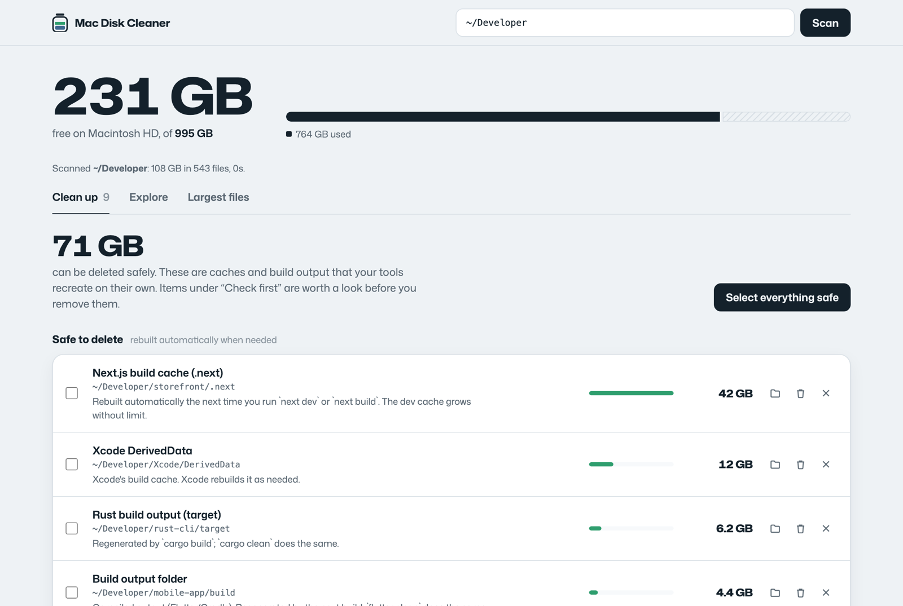
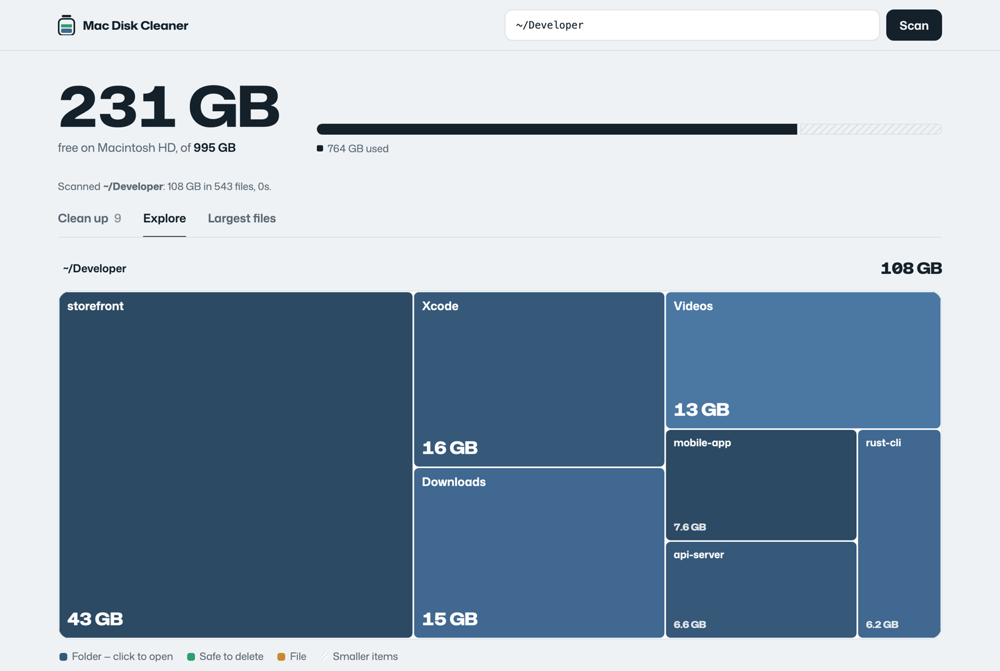

# Mac Disk Cleaner

**Free, open-source disk space cleaner for macOS.** It finds the hidden folders that make System Settings say *“Documents: 403 GB”* — runaway build caches, Xcode leftovers, package-manager caches — and helps you delete them safely.

[](https://github.com/OpenStruct/mac-disk-cleaner/actions/workflows/ci.yml)
[](LICENSE)


[Website](https://openstruct.github.io/mac-disk-cleaner/) · [Download](https://github.com/OpenStruct/mac-disk-cleaner/releases/latest) · [Changelog](CHANGELOG.md)



## Why

macOS lumps everything it can't classify into “Documents” or “System Data”, and Finder hides dot-folders. On the machine this tool was built for, 403 GB of “Documents” turned out to be:

| Where | Size | What it was |
|---|---|---|
| `~/…/storefront/.next` | 162 GB | Next.js dev cache that never stops growing |
| `~/Library/Containers/com.docker.docker` | 84 GB | Unused Docker images and volumes |
| `~/Library/Developer/Xcode/iOS DeviceSupport` | 52 GB | Debug symbols for every iOS version ever plugged in |
| `~/.gradle`, `~/.npm`, `~/go` | 59 GB | Package caches |
| `~/Library/Developer/Xcode/DerivedData` | 20 GB | Xcode build cache |

No single file was big — the space was spread across hundreds of thousands of small ones. Mac Disk Cleaner adds them up for you.

## Install & run

Needs only the `python3` that ships with macOS (the first run may offer to install Apple's Command Line Tools).

```bash
git clone https://github.com/OpenStruct/mac-disk-cleaner.git
cd mac-disk-cleaner
python3 diskclean.py
```

No git? Download and run the latest release:

```bash
curl -L https://github.com/OpenStruct/mac-disk-cleaner/archive/refs/tags/v1.0.0.tar.gz | tar xz
python3 mac-disk-cleaner-1.0.0/diskclean.py
```

Your browser opens `http://127.0.0.1:8765` and scanning starts. A full home folder (~5 million files) takes a few minutes.

Options: `--port 9000`, `--no-open` (don't open a browser), `--no-scan` (don't scan on launch), `--version`.

## What you get

- **Clean up** — every regenerable folder it found, grouped into *safe to delete*, *check first*, and *clean with a command* (for things like Docker, where deleting the folder by hand would break it). Select all safe items and free the space in one go.
- **Explore** — a treemap of any folder, so the 162 GB tile is impossible to miss. Click to drill down; caches that are safe to delete show in green.
- **Largest files** — the 300 biggest files, with Show in Finder, Trash and Delete on each.



### What it detects

| Kind | Examples | Marked |
|---|---|---|
| Build output | `.next`, `.nuxt`, `.svelte-kit`, `.turbo`, Flutter `build`, Rust `target`, `.dart_tool` | safe |
| Dependencies | `node_modules`, CocoaPods `Pods`, Gradle project caches | safe |
| Xcode | DerivedData, iOS DeviceSupport | safe |
| Xcode | Archives, Simulators | check first |
| Package caches | npm, Gradle, Go build/modules, pip, pub, app caches in `~/Library/Caches` | safe |
| Big data you chose to keep | LM Studio / Hugging Face models, Android system images, Python venvs, agent worktrees | check first |
| Docker | images, containers, volumes | command: `docker system prune` |
| Trash | `~/.Trash` | empty |

## Safety

- **Runs only on your Mac.** No account, no telemetry, no network calls. The server listens on `127.0.0.1` only, and every API request needs a random token generated at launch, so other websites can't drive it.
- **Only inside your home folder.** Core folders (`~/Documents`, `~/Library`, …) can't be removed as a whole, and keychains, iCloud Drive, Mail, Messages, Photos libraries, Docker's data folder and `.git` folders are always refused.
- **Trash or delete — your call.** *Move to Trash* is reversible. *Delete permanently* frees space immediately and is meant for caches.
- **Read the code.** It's ~600 lines of Python and one HTML file. No dependencies.

Some folders are protected by macOS privacy controls and are skipped (the app tells you how many). To include them, give your terminal app **Full Disk Access** in System Settings → Privacy & Security.

## How it works

`diskclean.py` walks the folder with `os.scandir` across a thread pool, staying on one volume and never following symlinks. Sizes come from allocated blocks, so sparse files like `Docker.raw` report what they actually use and hard links count once. Small items are folded together to keep memory low. The UI (`index.html`) is plain HTML/CSS/JS served by the same process.

## Contributing

New cleanup rules are the most useful contribution — see [CONTRIBUTING.md](CONTRIBUTING.md). Run the tests with `python3 -m unittest -v test_diskclean`.

## License

[MIT](LICENSE) © OpenStruct. Bundles [Mona Sans](https://github.com/github/mona-sans) under the [SIL Open Font License](static/OFL.txt).
